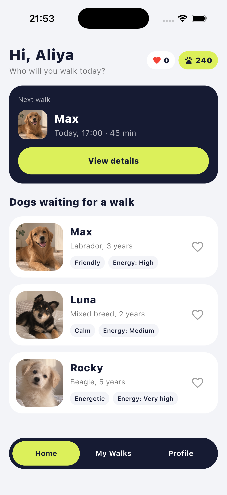
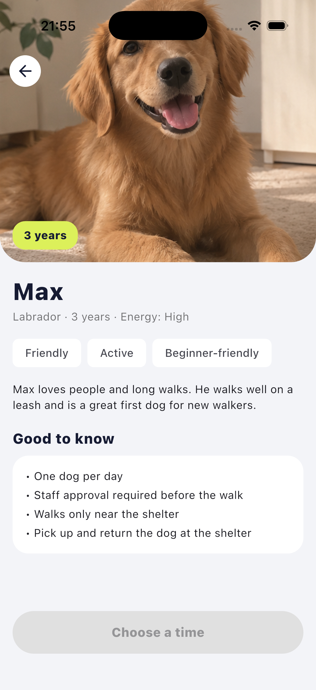
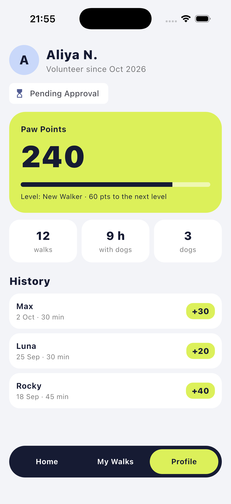

# 🐾 PawTime

A mobile app (Flutter) that connects an animal shelter with people who want to
spend time with shelter dogs by taking them on walks, without adopting.

## Problem
Shelter dogs need regular exercise, attention and social contact. Many people
want to help animals but cannot adopt a pet permanently. PawTime connects them:
users browse dogs, choose a time slot and book a walk. At the start the app
works with one shelter, without delivery: the dog is picked up and returned
at the shelter.

## Target user
People who love dogs but cannot adopt (students, people in rented flats,
volunteers) and want a safe, organised way to walk shelter dogs.

## Features (Milestone 1)
- Home screen with greeting, "Next walk" card and dog cards (photo, name, breed, age, tags)
- Favorite button ❤️ with live counter (`StatefulWidget` + `setState`)
- Dog details screen: photo with `Stack` overlay (age badge, back button), tags, walk rules
- Time slot selection and "Book a Walk" button with booked state (`setState`)
- Profile screen: Paw Points, level, stats and walk history (demo data)
- Custom bottom navigation: Home, My Walks, Profile

## Walk rules (planned logic)
- One dog per day
- Staff approval required before the first walk
- New walkers walk only near the shelter
- Paw Points are awarded after staff confirms a completed walk

## Planned (next milestones)
- Staff role: approve users and confirm completed walks
- Database and REST API
- Real one-dog-per-day booking logic
- BLoC architecture
- Search and filters, "My Walks" screen

## Screenshots
| Home | Dog Details | Profile |
|------|-------------|---------|
|  |  |  |

## Project structure
```
lib/
├── models/      # Dog model and demo data
├── screens/     # Main, Home, Dog Details, Profile
├── theme/       # App colors
├── widgets/     # DogCard, DogImage, PawBottomNav
└── main.dart
assets/images/   # Dog photos
```

## Run
```
flutter pub get
flutter run
```

## Author
Dina Kuralbay
